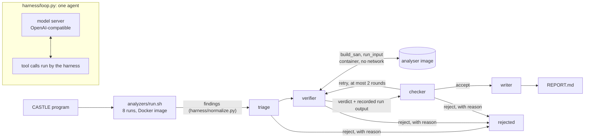

# c-bug-harness

This repository measures how much an agent harness helps a small local model find bugs in C, with the model fixed. The test set is the 250 programs of [CASTLE](https://github.com/CASTLE-Benchmark/CASTLE-Benchmark). It compares three conditions:

- **Analysers alone**, with no model, as the reference.
- **Model alone**, with CASTLE's own prompt.
- **Model plus harness**: analysers, then triage, then a verifier and a checker that can send work back to it, then a writer.

The work proposal is in `proposal/proposition.tex` (French). The papers the design draws on are in `docs/related-work.md`.



Each agent is one file in `agents/`: a header giving its tools and turn limit, then its prompt. `harness/pipeline.py` chains the agents, and `harness/loop.py` runs one agent against the model server. The model never runs anything itself. The harness runs the tool and sends the real output back to the model.

## Layout

- `analyzers/`: the analyser image (flawfinder, cppcheck, GCC `-fanalyzer`, Clang SA, Infer, ESBMC, Frama-C EVA), with versions and flags in `analyzers/README.md`.
- `agents/`: the triage, verifier, checker and writer prompts.
- `harness/`:
  - `normalize.py`: analyser reports to findings;
  - `castle.py`: the CASTLE answer parser and score, ported from CASTLE-Source;
  - `loop.py`, `pipeline.py`, `tools.py`: the harness;
  - `run.py`, `score.py`: the conditions and the result table.
- `scripts/`:
  - `fetch.sh`: CASTLE at a fixed commit, plus the model files checked against `models.lock`;
  - `serve.sh`: `llama-server` in Docker;
  - `check_proposal.py`: checks that the proposal cites only tracked files and the numbers in the code.
- `agent-eval/`: an Antigravity CLI smoke test, kept for a later Gemini run.

## Run

```bash
make test lint                    # no GPU, no Docker, no dataset needed
make docker-analyzers             # builds the analyser image (6.7 GB), runs analyzers/test.sh
scripts/fetch.sh                  # CASTLE + model files
python -m harness.analyze         # analysers on all 250 programs -> runs/raw/
python -m harness.run analyzers
scripts/serve.sh qwen3.5-9b
python -m harness.run llm     --label qwen3.5-9b --per-cwe 1
python -m harness.run harness --label qwen3.5-9b --per-cwe 1
python -m harness.score
python scripts/check_proposal.py
```

On Git Bash for Windows, prefix the Python commands with `MSYS_NO_PATHCONV=1` so Docker receives the mount paths unchanged.

## Status and limits

- **Tested**:
  - `tests/test_harness.py` runs the loop against a scripted server and covers the verifier and checker rounds;
  - `analyzers/test.sh` passes in the image;
  - the two verifier tools ran on a real CASTLE program.
- **Not run yet**: `scripts/serve.sh`, any model run, and the full analyser pass over the 250 programs.
- **Scoring quirk**: the CASTLE score keeps one quirk of the original notebook. After the first true positive, every Top 25 program earns its bonus, found or not (see `harness/castle.score`).
- **Scale**: 250 small single-file programs do not give a detection rate on real code.
